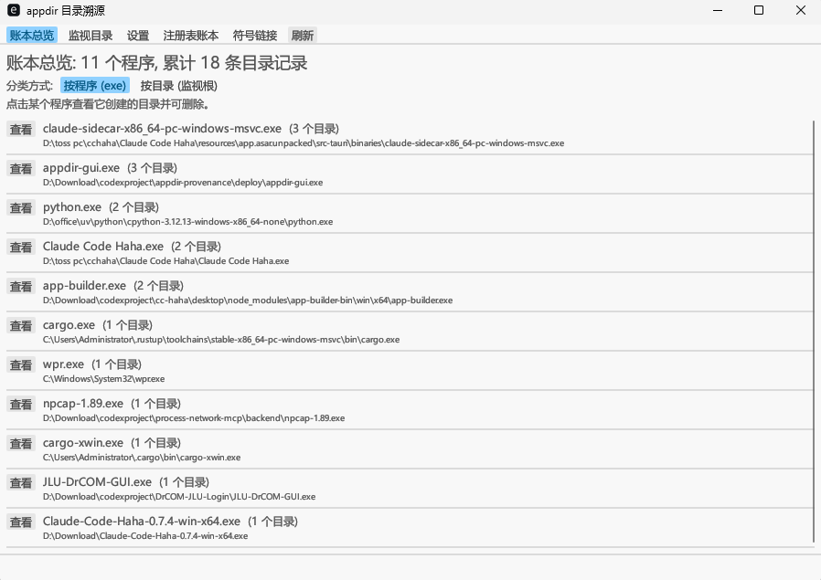

# appdir-provenance

Windows 目录溯源与清理工具。

它会监视你指定的文件夹，记录**哪个程序在其下新建了哪个子目录**，并把结果写入本地 SQLite 账本。
之后你可以按程序或按监视目录回看这些痕迹，并在确认后安全地清理不再需要的目录。

所有数据都保存在本机，不联网、不上传。



> 账本总览支持「按程序 (exe)」与「按目录 (监视根)」两种视图，可随时切换。

---

## 功能一览

### 目录账本
- 监视指定根目录，只记录**根目录的直接子目录**创建事件（不递归）。
- 通过 ETW 捕获创建动作，并解析出创建者的完整 EXE 路径。
- 使用独立的目录监听确认“确实是新建”，避免把“打开已有目录”误记为创建。
- 记录创建时间、创建者、监视根、来源与状态。
- **两种总览视图**：按程序（exe）分类，或按监视根（目录）分类。
- 明细页可查看每个目录的创建时间与当前状态。
- 目录若在你查看前已被删除，记录仍会保留并标注“原目录已不在”，可一键只清理账本记录（不碰文件）。

### 安全清理
- 只清理账本中有归属、且校验通过的目录。
- 默认先备份整棵目录树，再隔离重命名，最后删除。
- 路径受保护、创建者不符、创建时间不符、符号链接/重解析点、被占用或无权限的条目会被拦截，不可勾选删除。
- GUI 中需手动勾选并点击“删除选中”才会执行；不勾选不会动任何文件。

### 注册表账本（可选）
- 监视已知程序的注册表写入（键、值、时间）。
- 三种模式：关闭 / cache（5 秒缓存，覆盖“先写注册表、后建目录”的安装器）/ instant（即时判定，内存占用最小）。
- 只收录目录账本中已出现的程序，不会把全系统注册表活动都存下来。
- 打开明细时会自动清理已经失效的条目。

### 符号链接工具
- 批量选择文件或文件夹，在目标文件夹 B 的下一级创建同名符号链接，原件不动。
- “移动并创建”：先把源移动到 B，再在原位置创建指向新位置的链接。
- 同盘默认使用相对链接，跨盘自动回退为绝对链接。
- 可选“遇到占用自动解锁”：结束占用进程后重试；仍失败则中止并回滚已移动的文件。
- 历史记录中可删除链接本身，不会删除文件本体。

### 其他
- 开机自启：登录后自动启动后台采集。
- 账本路径、删除前备份、注册表监视模式均可在界面中设置。

---

## 系统要求

- Windows 10 / Windows 11（64 位）
- 后台采集需要**管理员权限**（ETW 会话要求）
- 无需安装其他软件；若系统提示缺少 `VCRUNTIME140.dll`，安装 Microsoft Visual C++ 2015–2022 运行库（x64）

---

## 安装

程序为绿色版，不需要安装程序。

1. 下载 Release 中的两个文件：
   - `appdir-core.exe`：后台采集进程
   - `appdir-gui.exe`：图形界面
2. **把两个 exe 放在同一个文件夹中**，例如 `D:\Tools\appdir`。
3. 建议放在普通可写目录，不要放在 `C:\Program Files` 下（程序需要在同目录写入配置和账本）。
4. 首次运行如果出现 Windows SmartScreen 提示：点击“更多信息”→“仍要运行”。

> 两个 exe 必须保持在同一目录：它们共享同目录下的 `appdir.json` 与 `ledger.db`，
> 且“开机自启”也依赖同目录的 `appdir-core.exe`。

首次运行会自动创建：

| 文件 | 用途 |
| --- | --- |
| `appdir.json` | 配置文件（账本路径、备份开关、注册表模式等） |
| `ledger.db` | SQLite 账本（运行时还会生成 `ledger.db-wal`、`ledger.db-shm`） |
| `backups\` | 删除前的备份目录（执行过清理后出现） |

---

## 快速开始

1. 双击 `appdir-gui.exe` 打开界面。
2. 进入 **监视目录** 页，输入要监视的文件夹绝对路径（例如 `D:\Downloads`），点击“添加”，并确认前面的勾选框已启用。
3. **以管理员身份运行 `appdir-core.exe`**，后台采集随即开始（控制台窗口会在几秒后自动隐藏）。
4. 正常安装或运行软件，让它们在监视目录下创建子目录。
5. 回到 GUI 的 **账本总览**，点击“刷新”即可看到记录。

希望登录后自动采集：**以管理员身份运行 `appdir-gui.exe`**，在 **设置** 页勾选“开机自启”。
程序会优先创建计划任务 `AppDirCore`（登录时以最高权限启动）；如果不是以管理员身份打开 GUI，
创建计划任务会失败并回退到当前用户的启动项，此时 ETW 可能拿不到管理员令牌。
可先取消自启，再用管理员身份重新开启以使用计划任务方式。

---

## 界面说明

### 账本总览

顶部提供两种分类方式，可随时切换：

- **按程序 (exe)**：每个程序一行，显示它创建了多少个目录。
- **按目录 (监视根)**：每个监视目录一行，显示该目录下捕获到多少个子目录、涉及多少个程序。已配置但没有记录的根目录也会显示。

如果某个目录在你查看之前已经被删掉了，它仍会留在列表里，只是标注为已失效——
勾选后执行的是“只删除账本记录”，不会影响磁盘上的任何文件。

点击“查看”进入明细：

- 每行显示目录完整路径、创建时间、当前状态；按目录视图还会显示创建者 EXE。
- 普通目录可直接勾选删除（会先备份）。
- 不可删除但可以“只清账本记录”的条目仍可勾选，行内会注明原因：
  - 原目录已不在（仅剩账本记录）
  - 符号链接 / junction：工具不会删除链接本身，只能清掉账本记录
- 其他被拦截的条目（被占用、身份不符、不在监视根内等）勾选框为禁用状态，鼠标悬停可看原因。
- 使用“全选 / 全不选”后点击“删除选中”执行清理。“全选”会勾上所有可操作的条目，
  包括失效条目和符号链接（它们只会清账本记录）。
- 按钮文案会随选择变化，选中了什么就显示什么：
  - 只选中仍在的目录 → “删除选中 (N)”（删目录，会备份）
  - 只选中已失效条目 → “原目录已不在，只删除账本中的记录 (N)”
  - 两类混选 → “删除选中 (目录 N + 账本记录 M)”
- 总览中的数量只统计仍存在的目录，失效记录单独标注为“N 条已失效”。

界面每 2 秒自动刷新一次，也可以点击顶部的“刷新”按钮。

### 监视目录

- “添加”：加入一个绝对路径作为监视根。
- 勾选框：启用/停用该根目录的采集。
- “移除”：从配置中删除该根目录（不会删除账本历史记录，也不会删除磁盘文件）。

注意：只监视根目录下的**直接子目录**。例如监视 `D:\Downloads` 时，
`D:\Downloads\App\Sub` 会记录 `App`，但不会单独记录 `Sub`；更下层的创建不会被采集。

### 设置

- **账本 SQLite 路径**：修改后点击“保存并重新打开账本”。后台 `appdir-core.exe` 需要重启后才会使用新路径。
- **删除前备份**：默认开启。备份保存在程序目录的 `backups\<目录名>-<时间戳>`。
- **注册表监视**：关 / cache / instant。修改后需要重启 `appdir-core.exe`。
- **开机自启**：为 `appdir-core.exe` 创建登录启动项。

### 注册表账本

- 列出目录账本中已知程序产生的注册表写入。
- 点击“查看”进入明细，可按条目删除，或“清空该程序记录”。
- 打开明细时会静默清理已经不存在的注册表值。
- 使用此功能前，需要先在设置中开启注册表监视并重启后台进程。

### 符号链接

**操作**页：

1. 点击“添加文件…”或“添加文件夹…”，可多次添加、混合添加。
2. 选择目标文件夹 B（可手输或点击“选择目标文件夹…”）。
3. 选择执行方式：
   - **创建**：在 B 的下一级为每个源创建同名链接，原件留在原位置。
   - **移动并创建**：先把源移动到 B 的下一级，再在原位置创建指向新位置的链接。
4. 点击执行后可在进度区查看状态，执行过程中可取消任务。

“遇到占用自动解锁”默认开启，仅对“移动并创建”生效：
当文件被其他进程占用导致移动失败时，工具会结束占用进程后重试；如果仍然失败，
会中止整批操作并回滚已经移动的文件。**此选项会强制结束进程，请确认可接受后再使用。**

**历史记录**页：

- 列出本工具创建过的链接位置、本体位置、创建时间与当前状态。
- 勾选“删除选中”只会移除符号链接本身，不会删除文件本体。

---

## 数据文件与备份

所有运行数据都在两个 exe 所在的目录：

- `appdir.json`：配置。不要用带 BOM 的编码保存；否则程序会报 JSON 解析失败。
- `ledger.db`：账本。运行时还有 `ledger.db-wal` 和 `ledger.db-shm`。
  **这三个文件是一个整体**，备份或迁移时请一起复制；不要在程序运行时单独删除 `-wal`/`-shm`。
- `backups\`：清理前的备份。确认无需恢复后可自行删除。

迁移到新位置：先退出 GUI，并在任务管理器中结束 `appdir-core.exe`，再把整个文件夹（含 WAL 文件）复制走。

---

## 命令行（可选，需自行构建）

Release 只包含两个 exe。`appdir.exe` 是开发/诊断用命令行前端，需要从源码构建：

```
cargo build --release -p appdir-cli
```

常用命令：

```
appdir monitor add <目录>              添加监视根
appdir monitor list                    列出监视根
appdir monitor enable|disable <目录>   启用/停用
appdir query exe <EXE完整路径>         查询某程序创建的目录
appdir query directory <目录路径>      查询某个目录的归属
appdir query all                       列出账本
appdir query ignored                   查看被丢弃的事件及原因
appdir clean --exe <EXE完整路径>       清理（默认 dry-run）
appdir clean --directory <目录路径>
     选项: --dry-run(默认) --backup --yes --max N
appdir daemon [--source watch|etw] [--seconds N]
appdir status | reconcile | selftest | version | help
```

`appdir selftest` 会在临时沙箱中走一遍“创建 → 采集 → 记账 → 查询 → 清理”，不会触碰真实用户数据。
`clean` 默认只预览；真正删除需要 `--yes`，建议同时加 `--backup`。

命令行使用独立的数据目录：默认 `%LOCALAPPDATA%\appdir-provenance`，
可用环境变量 `APPDIR_DATA_DIR` 或 `--data-dir` 覆盖。它**不会**自动使用 GUI 同目录下的账本，
除非显式指定。

---

## 常见问题

**采集不到新目录？**

- 确认根目录已添加并且处于启用状态。
- 只记录根目录的直接子目录；更深层目录不会单独记录。
- 确认 `appdir-core.exe` 正在运行，且以管理员身份启动。
- 若账本路径或注册表模式被修改过，重启 `appdir-core.exe`。

**“开机自启”后没有采集到数据？**

优先使用计划任务方式（设置时会请求管理员权限）。如果回退到当前用户启动项，
程序可能无法获得管理员令牌，表现为 ETW 启动失败。可删除自启后以管理员身份重新设置，
或手动以管理员身份运行 `appdir-core.exe`。

**关闭 GUI 后还会继续采集吗？**

会。GUI 只是查看和配置界面；采集由 `appdir-core.exe` 独立完成。

**为什么有些目录显示“原目录已不在”？**

说明这条记录对应的文件夹已经在磁盘上被删掉了（可能被其他程序或你手动清理）。
记录会保留在账本里，勾选它并执行删除时只会移除账本记录，不会影响任何文件。
如果想连记录一起清掉，直接勾选它再点删除即可。

**为什么有些目录没有创建者？**

创建者进程过短、解析失败或事件被过滤时，记录会被丢弃并计入忽略事件。
可用 `appdir query ignored` 查看原因。

**杀毒软件或 SmartScreen 报警？**

程序使用 ETW 和进程枚举，发布包未做代码签名，可能触发启发式告警。
可自行从源码构建。

**强制结束进程后采集异常？**

可能残留 ETW 会话。以管理员身份执行：

```
logman query -ets | findstr appdir
logman stop <会话名> -ets
```

**注册表账本为空？**

注册表监视默认关闭；需要在设置中选择 cache 或 instant 并重启 `appdir-core.exe`。
并且只记录目录账本中已出现的程序。

---

## 卸载

1. 在设置中关闭“开机自启”（或手动删除计划任务 `AppDirCore` / 启动项）。
2. 退出 GUI，在任务管理器中结束 `appdir-core.exe`。
3. 删除整个程序文件夹即可。

如需保留历史记录，请先备份 `ledger.db`（连同 `-wal`、`-shm`）和 `backups\`。

---

## 已知限制

- 只采集监视根的一级子目录，不递归。
- 注册表监视依赖 ETW 冷启动时的键句柄解析，部分事件无法还原完整键名（原理性损耗）。
- 注册表前缀过滤目前只能在 `appdir.json` 的 `reg_prefixes` 中配置，GUI 未提供编辑入口。
- 注册表明细在条目很多时，打开会逐条检查有效性，可能有短暂卡顿。
- 不追踪服务调用链、RPC 归属或完整进程树。
- 未实现内核驱动方案，当前全部为用户态。

---

## 从源码构建

需要 Rust 工具链（MSVC 目标）和 Windows SDK：

```powershell
cargo build --release --workspace
cargo test --workspace
```

产物位于 `target\release\`：

- `appdir-core.exe`
- `appdir-gui.exe`
- `appdir.exe`（命令行，可选）

发布时只需分发前两个 exe，并保持它们在同一目录。

---

## 更多文档

- [`docs/ETW.md`](docs/ETW.md)：ETW 采集实现细节
- [`docs/GUI-CORE.md`](docs/GUI-CORE.md)：GUI 与后台进程的协作方式
- [`docs/SECURITY.md`](docs/SECURITY.md)：清理安全模型
- [`docs/MINIFILTER.md`](docs/MINIFILTER.md)：未启用的内核驱动方案
- [`架构功能细节(AI看).md`](架构功能细节(AI看).md)：源码地图与改动指引（面向开发者）

---

## 许可

MIT
